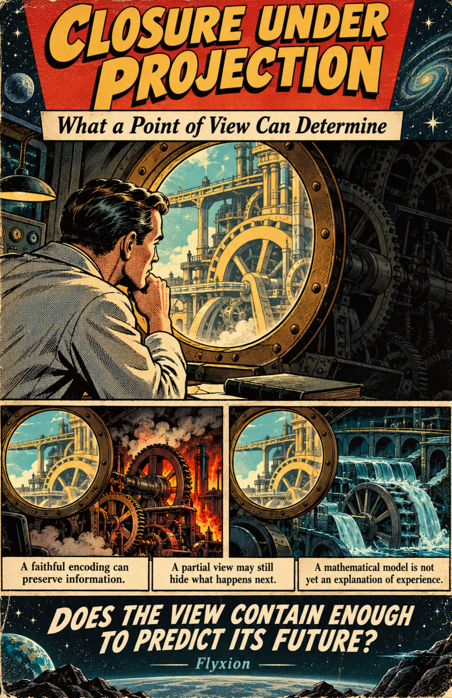
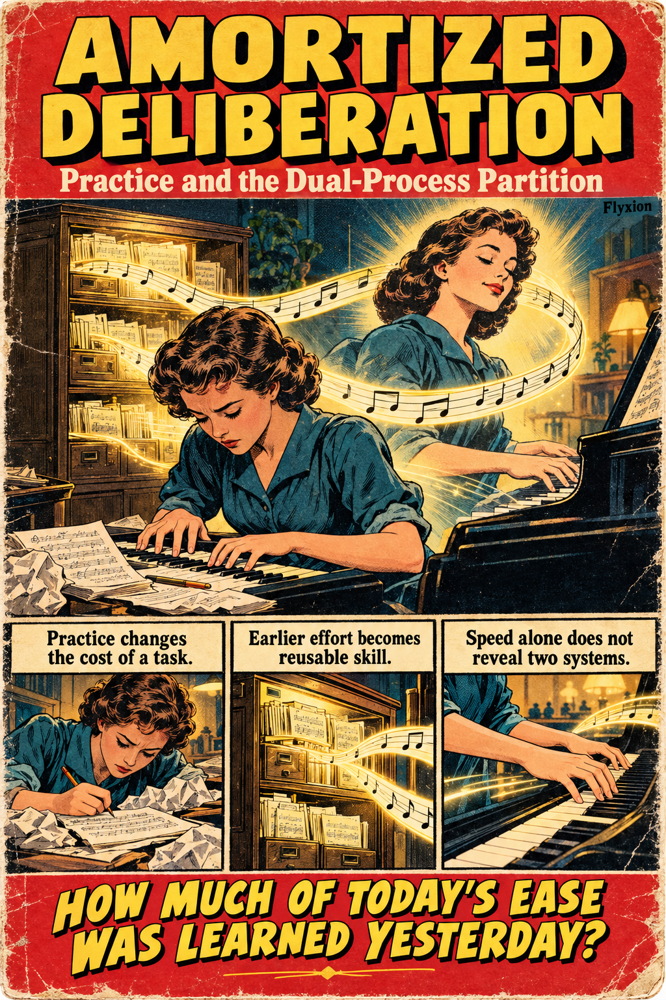
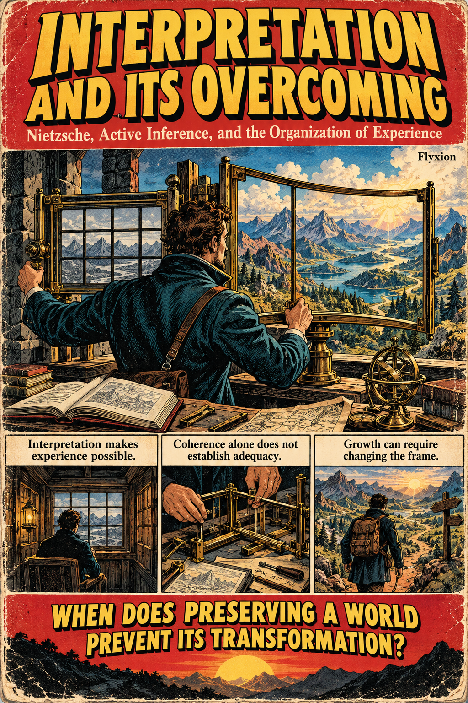

# Active Inference

[Amortized Deliberation](https://standardgalactic.github.io/active-inference/amortized-deliberation.pdf)

[Closure Under Projection](https://standardgalactic.github.io/active-inference/closure-under-projection.pdf)

[Interpretation and Its Overcoming](https://standardgalactic.github.io/active-inference/interpretation-and-its-overcoming.pdf)

# Further Notes

[Transcription Error and Causal Identifiability](causal-identifiability.md)

[Generative Audio as Compression](generative-audio.md)
